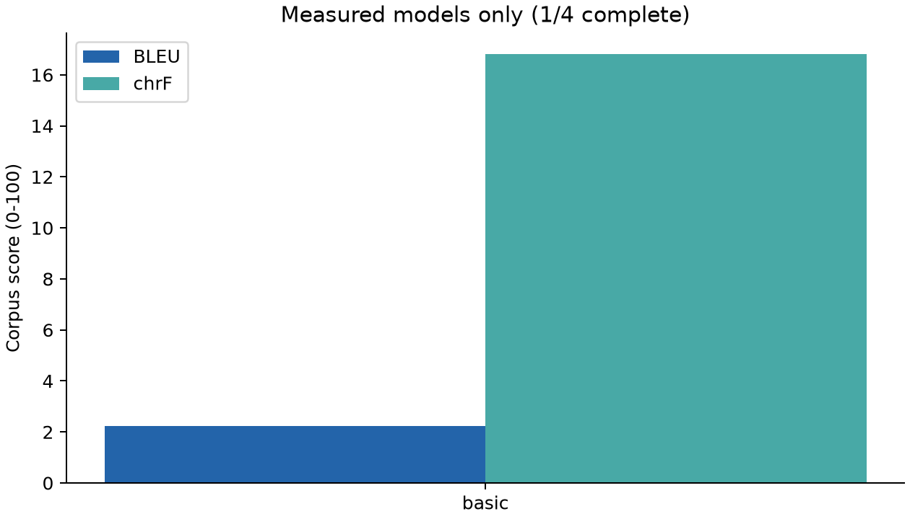
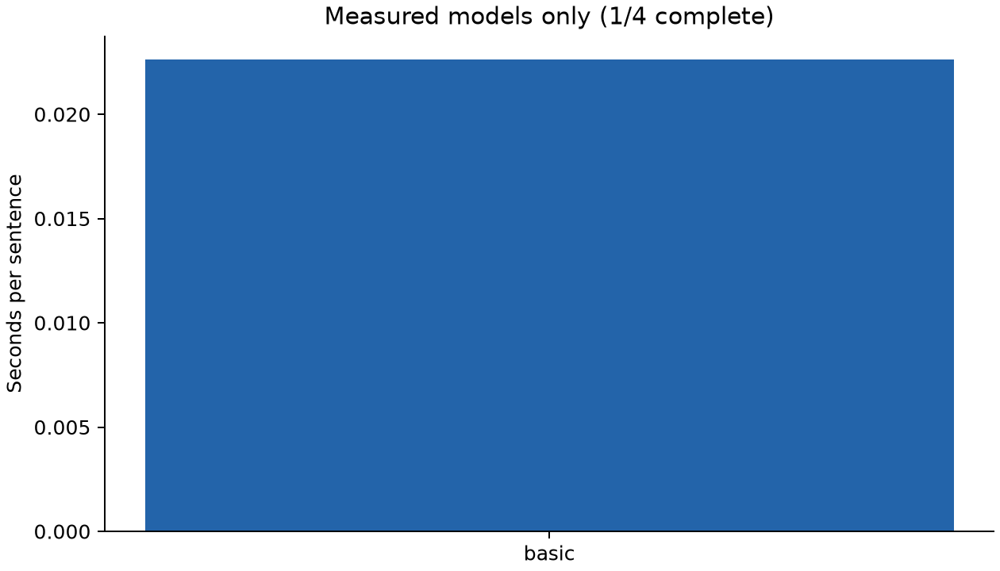
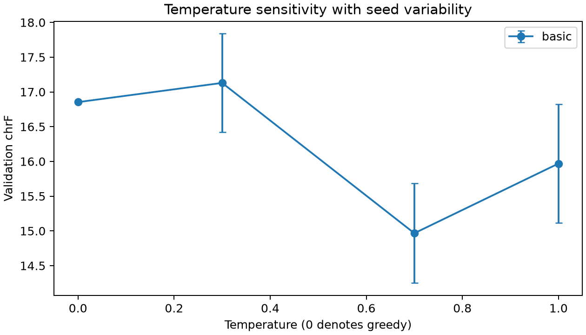

# English to French Translation with Four Transformer Models

**Foundations of Generative AI (ICT4403), Assignment 3**  
**Parth Upadhyay · 230953328**

This project compares a basic Transformer, mT5, LLaMA and Gemma on English-to-French machine translation. The objective is to measure translation quality and computation under a shared evaluation protocol, then examine translation errors and responsible-use concerns.

**Current status:** the basic Transformer has been trained and evaluated. The mT5, LLaMA and Gemma execution paths are supplied for you to run. Their final experiments have not been run in this package. This is a GitHub-ready project with run instructions; it is **not yet a completed four-model assignment or LMS-ready submission**. No scores or model rankings are invented. See [the requirement checklist](docs/REQUIREMENTS.md).

## Dataset and preprocessing

- Source language: English. Target language: French.
- Dataset: Tatoeba parallel sentences distributed by [ManyThings](https://www.manythings.org/anki/), using the fixed 2019-04-07 snapshot hosted at [TensorFlow's public download URL](https://storage.googleapis.com/download.tensorflow.org/data/fra-eng.zip).
- The original dataset notice is retained in [DATASET_NOTICE.txt](data/DATASET_NOTICE.txt). It identifies Tatoeba contributors, ManyThings, and CC BY 2.0. The historical snapshot has two columns and does not contain contributor IDs. The full corpus is downloaded locally and is excluded from Git; the reported evaluation examples retain dataset attribution and original line numbers. Consult the upstream terms before redistributing a larger corpus.
- Unicode NFC normalization and whitespace cleanup preserve accents, punctuation and casing in the dataset. Empty/malformed rows and pairs outside 2-16 whitespace-separated words per side are removed. Duplicate source **or** target sentences are removed before shuffling, using case-insensitive keys. The first surviving translation is retained.
- A seeded shuffle selects **3,000 training, 200 validation and 200 test pairs**. Unselected pairs are unused. [The manifest](data/manifest.json) records the source archive's SHA-256, filter counts, split IDs and seed. Repeated source or target strings cannot cross splits. Vocabulary fitting, prompts and checkpoint selection do not use test references.
- The downloaded snapshot contains 167,130 pairs. Length filtering removes 1,390 and source/target deduplication removes 54,196, leaving 111,544 eligible pairs before the 3,400-pair sample is selected.
- This is a sentence-level split, not a document- or contributor-level split. Near duplicates, stylistic overlap and possible foundation-model pretraining contamination remain limitations. Short, isolated sentences underrepresent document translation, regional varieties and complex discourse.

## Models and adaptation

| Model | Architecture | Implementation and adaptation |
|---|---|---|
| Basic Transformer | Encoder-decoder | PyTorch `nn.Transformer`; 2 encoder and 2 decoder layers, hidden size 128, 4 heads, feed-forward size 512, sinusoidal positions, dropout 0.1. Separate training-only vocabularies, capped at 4,000 entries each. Trained from scratch for 20 epochs with AdamW. |
| [mT5-small](https://huggingface.co/google/mt5-small) | Encoder-decoder | Multilingual pretrained checkpoint; full supervised fine-tuning for 3 epochs with Adafactor, gradient accumulation and gradient checkpointing. Validation loss selects the checkpoint. |
| [Llama 3.2 1B Instruct](https://huggingface.co/meta-llama/Llama-3.2-1B-Instruct) | Decoder-only | Official Meta checkpoint, adapted by three-shot prompting using training examples and its chat template. No task fine-tuning; training time is N/A. |
| [Gemma 3 270M IT](https://huggingface.co/google/gemma-3-270m-it) | Decoder-only | Official Google checkpoint, with the same three examples and translation instruction, formatted using its own chat template. No task fine-tuning; training time is N/A. |

All pretrained revisions are pinned in [config.json](config.json). Exact parameter counts are counted from loaded tensors rather than inferred from model names. The actual basic Transformer has 2,183,115 parameters. mT5 has been pretrained for text denoising and must be fine-tuned for this task; an unfine-tuned mT5 result is not substituted.

## Execution

Use Python 3.11. A GPU with at least 12-16 GB VRAM is recommended for the complete experiment; mT5 full fine-tuning may exceed a 4 GB GPU even at batch size one. CPU execution is supported but considerably slower. The code loads one model at a time. Model downloads require several GB of disk space and internet access. Do not upload weights, caches, credentials or the virtual environment to GitHub.

### Windows PowerShell

Open PowerShell in this folder:

```powershell
py -3.11 -m venv .venv
.\.venv\Scripts\python.exe -m pip install --upgrade pip
# Install a suitable CUDA PyTorch build first if needed; see https://pytorch.org/get-started/locally/
.\.venv\Scripts\python.exe -m pip install -r requirements.txt
.\.venv\Scripts\python.exe -m unittest discover -s tests -v
```

Visit both official LLaMA and Gemma model pages, sign in and accept/request their access terms. Then authenticate **locally**; never put a token in source code, a notebook cell or Git:

```powershell
.\.venv\Scripts\huggingface-cli.exe login
.\.venv\Scripts\python.exe run.py preflight
.\.venv\Scripts\python.exe run.py prepare
.\.venv\Scripts\python.exe run.py run --device cuda
.\.venv\Scripts\python.exe run.py verify
```

For CPU, replace `--device cuda` with `--device cpu`. For Linux/macOS, use `python3 -m venv .venv`, activate it with `source .venv/bin/activate`, then use `python` and `huggingface-cli` for the same commands. [The Colab notebook](Assignment3_Colab.ipynb) provides the GPU workflow after the repository exists.

Run or retry individual models without rerunning the others:

```powershell
.\.venv\Scripts\python.exe run.py run --models mt5 --device cuda
.\.venv\Scripts\python.exe run.py run --models llama gemma --device cuda
.\.venv\Scripts\python.exe run.py report
.\.venv\Scripts\python.exe run.py verify
```

`--reuse-checkpoints` re-evaluates matching locally trained basic/mT5 checkpoints without training again. Checkpoints are intentionally excluded from the upload package, so train once before using this flag on a new computer. To make a fully comparable hardware/timing comparison, rerun **all four models on the same machine**, including the included basic baseline. Do not compare the laptop baseline timing with cloud timings as though the hardware were identical.

An access error requires accepting the relevant model terms and logging in. An out-of-memory error requires a larger GPU or `--device cpu`. Use the supported dependency versions; the included basic run used local PyTorch 2.5.1, whereas the full workflow requires PyTorch 2.6 or newer for mT5's upstream weight-loading requirements. Changing config or data invalidates checkpoints and previous cross-model comparisons. Rerun all affected models. All reported training and inference numbers are measurements, not runtime estimates.

## Evaluation design

The same 200 test rows, order, references and greedy decoding policy are used for all four models. Batch size is one at inference and the output cap is 64 new tokens. Inputs are checked for overflow; they are never silently truncated. Models use different tokenizers, so token caps are comparable limits rather than equal text lengths. Model-native EOS tokens stop generation. Decoder-only input prompts are removed from predictions. Generated explanations are retained and penalized rather than manually edited out.

SacreBLEU 2.5.1 computes corpus BLEU (`13a`, mixed case, exponential smoothing) and chrF (character order 6, beta 2, word order 0). Metric signatures are saved. **Primary ranking metric: chrF; tie-breaker: BLEU.** No overall winner is declared until all four models complete. On a small single-reference test set, legitimate alternate translations may score poorly; automatic metrics must be interpreted alongside samples. Exact stochastic results may vary across devices and library versions despite seeded runs.

<!-- RESULTS_START -->
## Measured results

1 of 4 models have completed training/adaptation, test evaluation, temperature experiments and audit generation. Pending entries are unmeasured, not zero scores.

| Model | BLEU | chrF | Training / tuning (s) | Inference (s) | s / sentence | Parameters |
|---|---:|---:|---:|---:|---:|---:|
| basic | 2.24 | 16.81 | 29.67 | 4.52 | 0.0226 | 2,183,115 |
| mt5 | pending | pending | pending | pending | pending | pending |
| llama | pending | pending | pending | pending | pending | pending |
| gemma | pending | pending | pending | pending | pending | pending |

The shared held-out test set contains 200 sentence pairs. BLEU and chrF are corpus-level SacreBLEU scores on a 0-100 scale. Raw predictions, timing, token-limit flags, model revisions and metric signatures accompany each model.

| Model | Hardware | Precision | Output-cap hits |
|---|---|---|---:|
| basic | NVIDIA GeForce RTX 3050 4GB Laptop GPU | torch.float32 | 0 |





## Sampling temperature analysis

The primary test comparison uses greedy decoding (sampling disabled). The temperature experiment uses the same validation subset for all models, with top-p=0.9, top-k disabled, and three seeds per nonzero temperature. Greedy decoding runs once. Mean and sample standard deviation below describe seed variability, not confidence intervals. No temperature is selected using the test set.

| Model | Temperature | Runs | Validation BLEU mean ± SD | Validation chrF mean ± SD |
|---|---:|---:|---:|---:|
| basic | 0 | 1 | 3.68 ± 0.00 | 16.85 ± 0.00 |
| basic | 0.3 | 3 | 3.27 ± 0.82 | 17.13 ± 0.71 |
| basic | 0.7 | 3 | 2.33 ± 0.46 | 14.97 ± 0.72 |
| basic | 1 | 3 | 1.51 ± 0.37 | 15.97 ± 0.86 |

For basic, the highest observed mean validation chrF is 17.13 at temperature 0.3; the greedy baseline is 16.85. This small validation experiment does not establish a general optimum.



## Model comparison and conclusion

**The four-model comparison is incomplete. No overall best-performing model can yet be identified.** Run the remaining models and regenerate this section before submitting.

The basic Transformer starts with random weights and learns a word/punctuation vocabulary only from training sentences. mT5 starts from multilingual pretraining and receives supervised task fine-tuning. LLaMA and Gemma use instruction-tuned checkpoints with three training examples in their prompts. Differences in parameter counts, tokenization, pretraining, prompt length and adaptation prevent a controlled architecture-only comparison. The same token cap is not the same character budget across tokenizers; inspect cap-hit counts. Inference timing uses batch size one, synchronization and a warm-up, and includes tokenization and decoding but excludes model loading, downloads and scoring. Training timing includes validation and best-checkpoint writes, but excludes loading and tokenization.

<!-- RESULTS_END -->

## Responsible AI and translation samples

Read [the ethics analysis](docs/ETHICS.md), [the measured basic-model review](docs/BASIC_MODEL_REVIEW.md), and [the sample inspection guide](docs/REVIEW_GUIDE.md). Each model produces six authored diagnostic translations in `results/<model>/ethics_samples.jsonl`, separate from the scored test set. The probes cover gender/occupation, hallucinated facts, idioms, sensitive negation and respectful treatment of refugees. They are diagnostic examples, not a statistical fairness benchmark. Complete a qualitative review for all four models after running them.

Each model's `predictions.jsonl` stores original test IDs, source/reference, generated translation, elapsed time, token count and cap-hit flag. `temperature_predictions.jsonl` preserves sampled outputs. Inspect omissions, additions, named entities, quantities, negation and changes of register. Do not deploy these experiments for consequential translation without qualified bilingual review.

## Repository layout

```text
config.json                 Reproducible experiment settings and model revisions
run.py                      Prepare, preflight, train/evaluate, report, verify
mt/                         Dataset, models, training, experiments, reporting
tests/                      Leakage, causal masking, learning and metric checks
data/manifest.json          Dataset checksum, preprocessing counts and split IDs
results/                    Measured predictions, scores, plots and completion state
docs/                       Ethics, analysis, requirement mapping, upload instructions
submission/                 Named Word/PDF document and identity configuration
scripts/                    Build submission document and clean upload archive
Assignment3_Colab.ipynb      GPU run workflow
```

## Submission and GitHub

Suggested repository name: **fgai-assignment3-machine-translation**. Follow [UPLOAD_AND_SUBMIT.md](docs/UPLOAD_AND_SUBMIT.md). Upload the contents of this folder or the provided clean archive. Keep the repository accessible to the evaluator. The generated Word/PDF files already contain the student name and registration number; their repository link is explicitly pending. Add the real URL, rebuild the Word document, and use Word **File > Save As > PDF** after completing and reviewing all four runs. Submit that final PDF to LMS yourself.

## Sources

- [Assignment dataset source](https://www.manythings.org/anki/) and [Tatoeba terms](https://tatoeba.org/en/terms_of_use).
- [Attention Is All You Need](https://arxiv.org/abs/1706.03762) for the basic encoder-decoder Transformer.
- [mT5 paper](https://arxiv.org/abs/2010.11934) and [official checkpoint](https://huggingface.co/google/mt5-small).
- [Official LLaMA model card and license](https://huggingface.co/meta-llama/Llama-3.2-1B-Instruct).
- [Official Gemma model card and license](https://huggingface.co/google/gemma-3-270m-it).
- [SacreBLEU implementation and metric signatures](https://github.com/mjpost/sacrebleu).

AI assistance was used to prepare this implementation and documentation. Review the code, run the remaining experiments, understand the results and follow any applicable institutional disclosure requirements. This statement does not assert any additional rule absent from the assignment PDF.
