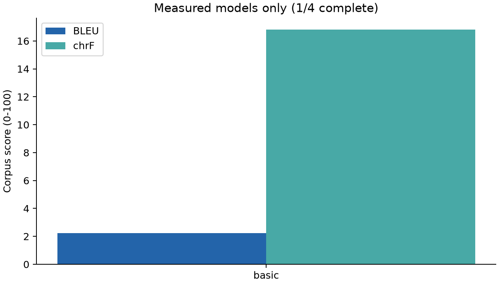
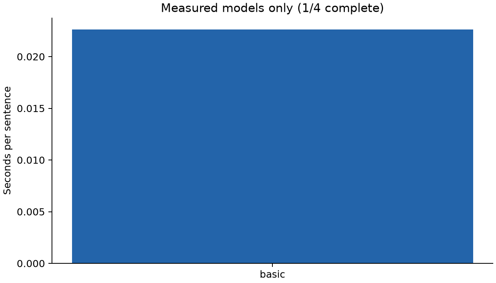
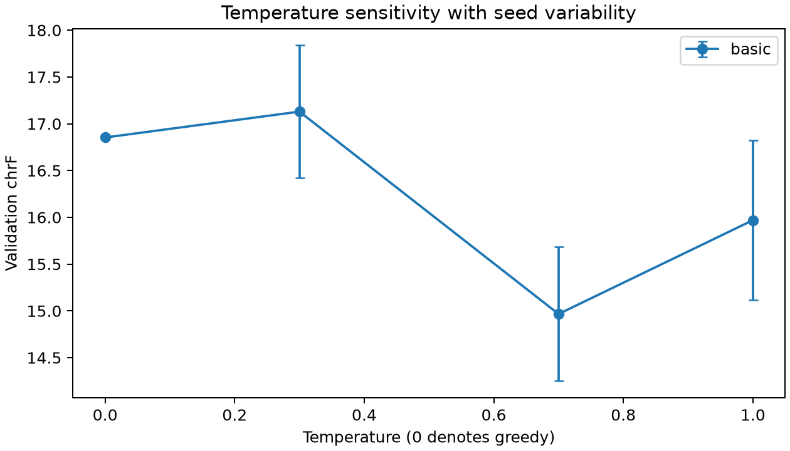

## Measured results

1 of 4 models have completed training/adaptation, test evaluation, temperature experiments and audit generation. Pending entries are unmeasured, not zero scores.

| Model | BLEU | chrF | Training / tuning (s) | Inference (s) | s / sentence | Parameters |
|---|---:|---:|---:|---:|---:|---:|
| basic | 2.24 | 16.81 | 29.67 | 4.52 | 0.0226 | 2,183,115 |
| mt5 | pending | pending | pending | pending | pending | pending |
| llama | pending | pending | pending | pending | pending | pending |
| gemma | pending | pending | pending | pending | pending | pending |

The shared held-out test set contains 200 sentence pairs. BLEU and chrF are corpus-level SacreBLEU scores on a 0-100 scale. Raw predictions, timing, token-limit flags, model revisions and metric signatures accompany each model.

| Model | Hardware | Precision | Output-cap hits |
|---|---|---|---:|
| basic | NVIDIA GeForce RTX 3050 4GB Laptop GPU | torch.float32 | 0 |

## Sampling temperature analysis

The primary test comparison uses greedy decoding (sampling disabled). The temperature experiment uses the same validation subset for all models, with top-p=0.9, top-k disabled, and three seeds per nonzero temperature. Greedy decoding runs once. Mean and sample standard deviation below describe seed variability, not confidence intervals. No temperature is selected using the test set.

| Model | Temperature | Runs | Validation BLEU mean ± SD | Validation chrF mean ± SD |
|---|---:|---:|---:|---:|
| basic | 0 | 1 | 3.68 ± 0.00 | 16.85 ± 0.00 |
| basic | 0.3 | 3 | 3.27 ± 0.82 | 17.13 ± 0.71 |
| basic | 0.7 | 3 | 2.33 ± 0.46 | 14.97 ± 0.72 |
| basic | 1 | 3 | 1.51 ± 0.37 | 15.97 ± 0.86 |

For basic, the highest observed mean validation chrF is 17.13 at temperature 0.3; the greedy baseline is 16.85. This small validation experiment does not establish a general optimum.

## Model comparison and conclusion

**The four-model comparison is incomplete. No overall best-performing model can yet be identified.** Run the remaining models and regenerate this section before submitting.

The basic Transformer starts with random weights and learns a word/punctuation vocabulary only from training sentences. mT5 starts from multilingual pretraining and receives supervised task fine-tuning. LLaMA and Gemma use instruction-tuned checkpoints with three training examples in their prompts. Differences in parameter counts, tokenization, pretraining, prompt length and adaptation prevent a controlled architecture-only comparison. The same token cap is not the same character budget across tokenizers; inspect cap-hit counts. Inference timing uses batch size one, synchronization and a warm-up, and includes tokenization and decoding but excludes model loading, downloads and scoring. Training timing includes validation and best-checkpoint writes, but excludes loading and tokenization.
