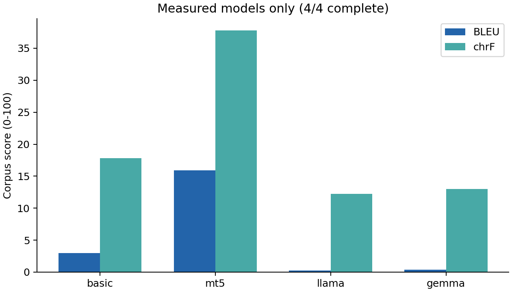
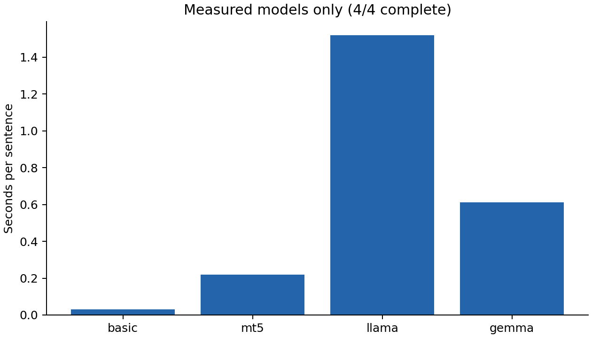
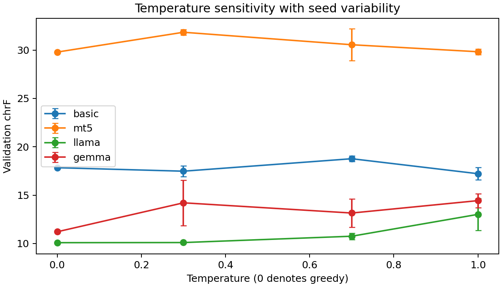

## Measured results

4 of 4 models have completed training/adaptation, test evaluation, temperature experiments and audit generation. Pending entries are unmeasured, not zero scores.

| Model | BLEU | chrF | Training / tuning (s) | Inference (s) | s / sentence | Parameters |
|---|---:|---:|---:|---:|---:|---:|
| basic | 2.99 | 17.83 | 35.37 | 6.08 | 0.0304 | 2,183,115 |
| mt5 | 15.89 | 37.76 | 1344.06 | 43.85 | 0.2192 | 300,176,768 |
| llama | 0.24 | 12.26 | N/A (prompted) | 303.75 | 1.5188 | 1,235,814,400 |
| gemma | 0.41 | 12.99 | N/A (prompted) | 122.50 | 0.6125 | 268,098,176 |

The shared held-out test set contains 200 sentence pairs. BLEU and chrF are corpus-level SacreBLEU scores on a 0-100 scale. Raw predictions, timing, token-limit flags, model revisions and metric signatures accompany each model.

| Model | Hardware | Precision | Output-cap hits |
|---|---|---|---:|
| basic | Tesla T4 | torch.float32 | 1 |
| mt5 | Tesla T4 | torch.float32 | 0 |
| llama | Tesla T4 | torch.bfloat16 | 186 |
| gemma | Tesla T4 | torch.bfloat16 | 0 |

## Sampling temperature analysis

The primary test comparison uses greedy decoding (sampling disabled). The temperature experiment uses the same validation subset for all models, with top-p=0.9, top-k disabled, and three seeds per nonzero temperature. Greedy decoding runs once. Mean and sample standard deviation below describe seed variability, not confidence intervals. No temperature is selected using the test set.

| Model | Temperature | Runs | Validation BLEU mean ± SD | Validation chrF mean ± SD |
|---|---:|---:|---:|---:|
| basic | 0 | 1 | 2.37 ± 0.00 | 17.84 ± 0.00 |
| basic | 0.3 | 3 | 2.09 ± 0.16 | 17.48 ± 0.56 |
| basic | 0.7 | 3 | 2.14 ± 0.09 | 18.77 ± 0.29 |
| basic | 1 | 3 | 1.88 ± 0.04 | 17.21 ± 0.64 |
| mt5 | 0 | 1 | 7.25 ± 0.00 | 29.80 ± 0.00 |
| mt5 | 0.3 | 3 | 9.05 ± 1.04 | 31.84 ± 0.29 |
| mt5 | 0.7 | 3 | 9.63 ± 1.50 | 30.55 ± 1.64 |
| mt5 | 1 | 3 | 7.84 ± 2.26 | 29.83 ± 0.29 |
| llama | 0 | 1 | 0.06 ± 0.00 | 10.08 ± 0.00 |
| llama | 0.3 | 3 | 0.06 ± 0.00 | 10.10 ± 0.07 |
| llama | 0.7 | 3 | 0.11 ± 0.08 | 10.75 ± 0.33 |
| llama | 1 | 3 | 0.53 ± 0.40 | 13.01 ± 1.64 |
| gemma | 0 | 1 | 0.21 ± 0.00 | 11.21 ± 0.00 |
| gemma | 0.3 | 3 | 0.92 ± 0.65 | 14.21 ± 2.35 |
| gemma | 0.7 | 3 | 1.39 ± 0.55 | 13.15 ± 1.46 |
| gemma | 1 | 3 | 1.75 ± 0.62 | 14.43 ± 0.73 |

For basic, the highest observed mean validation chrF is 18.77 at temperature 0.7; the greedy baseline is 17.84. This small validation experiment does not establish a general optimum.

For mt5, the highest observed mean validation chrF is 31.84 at temperature 0.3; the greedy baseline is 29.80. This small validation experiment does not establish a general optimum.

For llama, the highest observed mean validation chrF is 13.01 at temperature 1; the greedy baseline is 10.08. This small validation experiment does not establish a general optimum.

For gemma, the highest observed mean validation chrF is 14.43 at temperature 1; the greedy baseline is 11.21. This small validation experiment does not establish a general optimum.

## Model comparison and conclusion

Using chrF as the predeclared primary metric and BLEU as a tie-breaker, **mt5** is the best-performing model on this test set (chrF 37.76, BLEU 15.89). The highest BLEU belongs to mt5; basic has the lowest measured per-sentence latency. These rankings apply to these checkpoints, adaptation budgets, dataset subset and hardware; they do not establish architectural superiority.

The basic Transformer starts with random weights and learns a word/punctuation vocabulary only from training sentences. mT5 starts from multilingual pretraining and receives supervised task fine-tuning. LLaMA and Gemma use instruction-tuned checkpoints with three training examples in their prompts. Differences in parameter counts, tokenization, pretraining, prompt length and adaptation prevent a controlled architecture-only comparison. The same token cap is not the same character budget across tokenizers; inspect cap-hit counts. Inference timing uses batch size one, synchronization and a warm-up, and includes tokenization and decoding but excludes model loading, downloads and scoring. Training timing includes validation and best-checkpoint writes, but excludes loading and tokenization.
